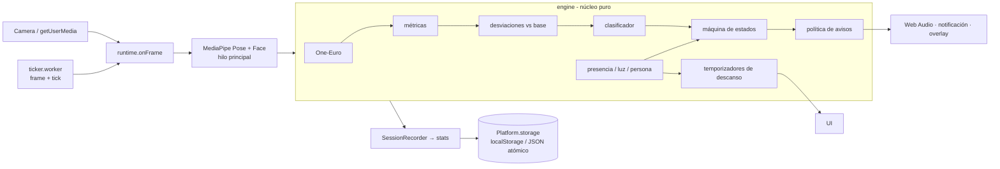

# Arquitectura y decisiones

## Resumen



El núcleo (`vision/filters|presence`, `posture/*`, `alerts/policy`, `breaks/timers`, `engine`, `stats`, `settings`) **no toca DOM, Electron, `Date.now`, `Math.random` ni `setTimeout`** (regla de ESLint): recibe un `Clock` y datos por inyección.

## Decisiones técnicas

| Decisión            | Elección                                                                                                                        | Justificación                                                                                                                                                                        | Estado                                                                                     |
| ------------------- | ------------------------------------------------------------------------------------------------------------------------------- | ------------------------------------------------------------------------------------------------------------------------------------------------------------------------------------ | ------------------------------------------------------------------------------------------ |
| Visión              | `@mediapipe/tasks-vision` 1.2.2, Pose Landmarker (lite) + Face Landmarker opcional                                              | Local (WASM+modelos empaquetados), 33 landmarks con oreja/hombro/cadera, matriz facial para cabeceo                                                                                  | Verificado que carga en Chromium con cámara simulada; precisión **no medida** con personas |
| Variante del modelo | `lite` por defecto                                                                                                              | Menor CPU; `full` descargable con `NECKGUARD_MODELS`                                                                                                                                 | **Spike pendiente** (CPU, latencia, estabilidad oreja/hombro)                              |
| Hilos               | (b) inferencia en hilo principal; **Worker solo para temporizadores/cadencia**                                                  | `getUserMedia` y `detectForVideo` sobre `<video>` viven en el hilo principal; el Worker evita el _throttling_ de pestañas en segundo plano; en Electron `backgroundThrottling:false` | **Spike pendiente**: medir (a) `ImageBitmap` al Worker                                     |
| UI                  | React 19 + Zustand                                                                                                              | Estado ligero; React Compiler lint activo                                                                                                                                            | —                                                                                          |
| Plataforma          | `Platform` (web / Electron) con test de contrato común                                                                          | Misma base de código                                                                                                                                                                 | Verificado con dobles                                                                      |
| Persistencia        | `KeyValueStorage` + esquema versionado (v3), migración v1→v2→v3, copia `.bak`, escritura atómica (tmp+fsync+rename en Electron) | Sin pérdida ante fallos a mitad de escritura                                                                                                                                         | Verificado con tests                                                                       |
| Electron            | app:// propio, `sandbox`, `contextIsolation`, CSP por cabecera, IPC validado, sin red                                           | Seguridad                                                                                                                                                                            | Compila, arranca y empaqueta; **no probado con cámara real**                               |

## Modelo de datos (`stats/model.ts`)

`Settings` · `CalibrationProfile` (base mediana+σ por métrica y ruido por desviación, por cámara y modo) · `SessionSummary` (agregados por intervalo, cortados al cambiar de día, con tiempo por nivel, por causa de no análisis y por franja horaria) · `AlertEvent` (con `recoveredMs`/`ignored`) · `BreakRecord` (`completed | declared | skipped | absence`, con ejercicio y tiempo fuera) · `AwayEpisode` (ausencia ≥ 30 s: `absent | standing | locked`) · `SittingBlock` (sedestación continua; las pausas < 3 min no la cortan) · `DailyRecord` (resumen diario permanente; lo anterior a 45 días se compacta ahí). El esquema **no admite** imágenes ni landmarks (validado en migración y guardado).

### Estadísticas y ausencias

El motor calcula un `ActivityState` por paso (`seated | absent | standing | locked | paused | nodata | light | notCalibrated`, ver `activityOf`) y `SessionRecorder` lo reparte en sesiones, franjas horarias, episodios de ausencia y bloques sentados. Solo `seated` cuenta para el porcentaje de buena postura; el resto se guarda por causa. `aggregateByDay/Week/Month` (`stats/aggregate.ts`) leen de `DailyRecord` (compactados + recientes), añaden `coverage` y `reliability`, y `stats/insights.ts` y `stats/advice.ts` convierten los agregados en pautas sin conclusiones si la fiabilidad es insuficiente.

## Máquina de estados

`OK → AVISO_LEVE (≥10 s ámbar) → MALA_POSTURA (≥20 s rojo o ≥2 min ámbar) → CRITICA (≥5 min rojo)`. Salida a `OK` solo tras ≥5 s en verde con 20 % de margen. Cada desviación tiene estado propio; global = más grave; mensaje = desviación de mayor prioridad del nivel global. El nivel solo baja por verde sostenido (decisión: evita parpadeos). Función pura `stepMachine(estado, entrada, cfg)`.

## Wireframes (texto)

```
Onboarding: [1 Bienvenida+legal] → [2 Señales de alerta] → [3 Cámara+modo] → [4 Sonido/notif.] → Calibración
Panel
┌ NeckGuard  Panel Estadísticas Ejercicios Ajustes Acerca de ─────────── (En pausa)┐
│ ┌ Cámara ───────────┐  ┌ Estado ───────────────────────────┐                     │
│ │ vídeo + esqueleto │  │ (✓ Postura correcta) mensaje      │                     │
│ │ (ocultable)       │  │ avisos: calibrar / luz / persona  │                     │
│ └───────────────────┘  ├ Indicadores clave (Δ vs base) ────┤                     │
│                        │ Cabeza adelantada ▓▓░░ +3.2%       │                     │
│                        │ Cabeza baja ▓░░░ +1.1°             │                     │
│                        │ Encorvamiento ▓░░░ …               │                     │
│                        ├ Tiempo sentado (anillo) ───────────┤                     │
│                        ├ Controles: Pausar · 15/30/60 · DND ┤                     │
└────────────────────────────────────────────────────────────────────────────────┘
Descanso (modal): título · ejercicio (SVG+pasos) · cuenta atrás · [Hecho][Posponer][Saltar]
Barra de menús: icono de color → popover (estado, sentado, próximo descanso, pausar, posponer, recalibrar, abrir)
```

## Riesgos y spikes pendientes

1. **Convención de la matriz facial** (columna-mayor, +z hacia la cámara) asumida; el signo del cabeceo lo absorbe la calibración, pero hay que verificarlo con cámara real. Sin Face Landmarker se usa un proxy nariz-ojos (heurístico).
2. **Cámara frontal**: slouch/hombros elevados dependen de cámara y silla fijas (se documenta y se sugiere recalibrar).
3. **Rendimiento** (<15 % CPU, <200 ms) sin medir en hardware real (ver docs/QA.md).
4. **Licencias** de MediaPipe y modelos: Apache-2.0 según el proveedor; revisión legal pendiente.
5. **Firma y notarización** requieren cuenta de Apple Developer (ver PACKAGING).
